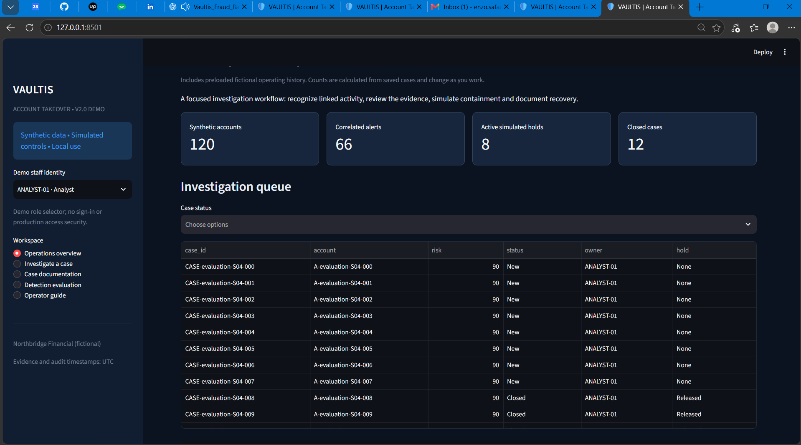

# VAULTIS — Account Takeover Detection & Response
**Independent simulated portfolio project | v2.0.1-demo | Private implementation**

VAULTIS explores how a digital banking fraud team connects suspicious account activity, investigates the evidence, simulates proportionate protective actions and documents customer recovery.

## Problem and use case
An unfamiliar-device login, recovery-contact change, new beneficiary and transfer attempt can appear in separate views. VAULTIS joins the account sequence into an explainable case. A legitimate urgent payment can look similar, so investigation and customer-friction evaluation are part of the design.

## Implemented local demonstration
- Ten reproducible synthetic scenario families and two temporal takeover rules.
- Evidence timeline, explainable risk signals and account-scoped investigation.
- Persistent cases, ownership and controlled workflow transitions.
- Staff documentation: notes, contacts, evidence, handovers, revisions and search.
- Simulated verification, holds, session revocation, credential reset and recovery.
- Reviewer-controlled release, closure and reopening.
- Audit history, case JSON reports and synthetic detection evaluation.

All actions are simulations. Demo identities are selectable without authentication. No real bank data, live payment decisions or production account protection is involved.

## Populated operating history
Fresh databases include **8 active simulated holds and 12 closed cases**, with persisted fictional case histories, notes and audit actions. Counts come from case records and change with operator work. Existing operator notes and state changes are preserved; they are not overwritten to force startup totals. See [startup summary](reports/DEMO_ACTIVITY.json).

## Validation and observed synthetic results
26 automated tests pass, including Streamlit interaction checks. A reproducible walkthrough completes note creation, simulated containment, recovery, reviewer release, closure and export. Windows launch and the initial V2 overview are confirmed; full desktop visual acceptance remains pending.

| 120 authored synthetic journeys | Result |
|---|---:|
| Attacks / legitimate journeys | 60 / 60 |
| True positives / missed attacks | 54 / 6 |
| False positives / true negatives | 12 / 48 |
| Precision / recall | 81.8% / 90.0% |
| False-positive rate | 20.0% |

Missing evidence creates misses; an urgent legitimate sequence creates false positives. Different development/evaluation seeds share the same scenario families. These results do not estimate real-bank effectiveness. No ROI, prevented loss or customer adoption is claimed.

## Project documentation
[Business case](docs/BUSINESS_CASE.md) · [Worked use case](docs/USE_CASE.md) · [System overview](docs/SYSTEM_OVERVIEW.md) · [Rules and data](docs/RULES_AND_DATA.md) · [Operator manual](docs/USER_MANUAL.md) · [Case documentation workspace](docs/CASE_DOCUMENTATION.md) · [Scope and acceptance](docs/V2_SCOPE.md) · [Verification](docs/VERIFICATION.md) · [Evaluation summary](reports/EVALUATION.json) · [Roadmap](docs/ROADMAP.md) · [Screenshot gallery](docs/SCREENSHOTS.md) · [Change log](CHANGELOG.md)

## Actual screenshots — V1 history
These are actual owner-supplied captures of the preceding v0.1.2 application, not previews of V2. A verified V2 overview screenshot is now available; the other workspaces still await visual review.

### SS2 — readable dashboard with ascending bars

### SS3 — investigation workspace

The [gallery](docs/SCREENSHOTS.md) retains SS1 and explains the evidence scope.

## Version preservation and source
Source and raw synthetic records stay in the private VAULTIS-Core repository. V1 documentation remains in [docs/V1](docs/V1/README.md); all preceding public content is preserved on `archive/v0.1.2-before-v2`. V2 delivers a local portfolio demonstration; production authentication, secure deployment, integrations and independent validation are outside this release.

## Verified V2 operations overview

Owner-supplied Windows capture, reviewed 2026-10-28: 120 synthetic accounts, 66 correlated alerts, eight active simulated holds and twelve closed cases. The visible queue includes closed cases with released holds. This confirms the overview renders and starter history loads; it does not verify every workflow interaction. See the [gallery](docs/SCREENSHOTS.md).
