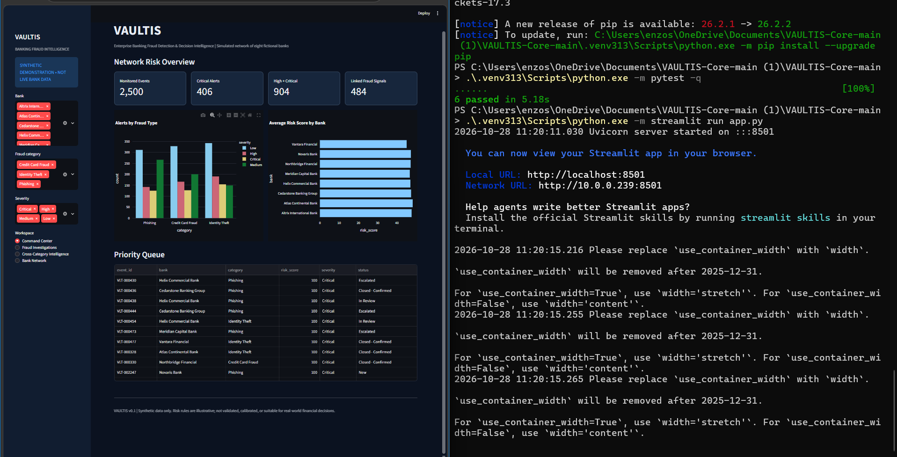
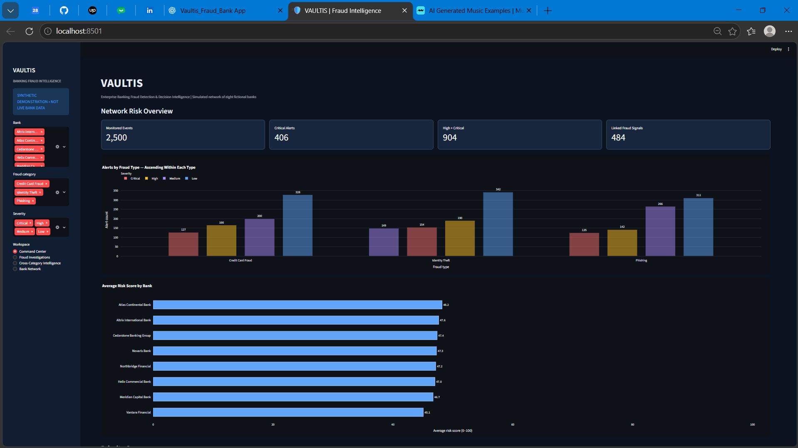
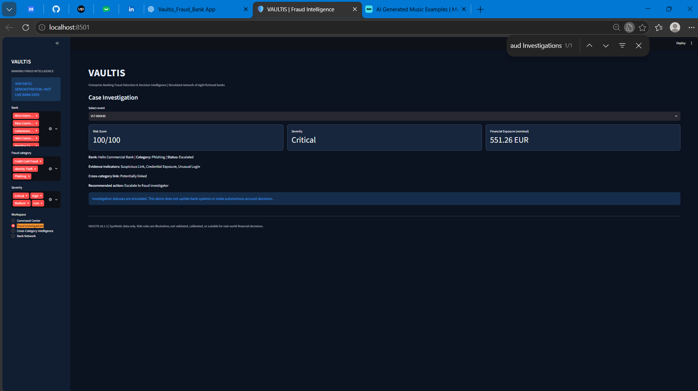

# VAULTIS — Historical Screenshots and Versions

The images below belong to the original broad multi-bank V1 prototype. They are retained as history and are not current V2 showcase images.

## V1 SS1 — original overview and test output

## V1 SS2 — v0.1.2 ascending-bar dashboard

## V1 SS3 — v0.1.2 investigation workspace

All three are original owner-supplied local captures. No generated UI imagery was used.

## Version preservation
- Original documentation: [docs/V1](V1/README.md).
- Pre-V2 source/documents: branch `archive/v0.1.2-before-v2`.
- Initial V2 before populated activity: branch `archive/v2.0.0-before-populated-demo`.
- Earlier verification snapshots remain on their existing archive branches; private source has additional pre-chart-patch branches.

Archive branches are in their respective repositories. Source visibility remains private; the public repository preserves public documentation and screenshots only.

[Return to current screenshots](SCREENSHOTS.md).
